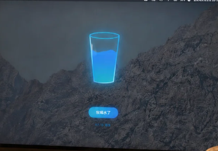
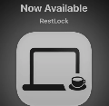
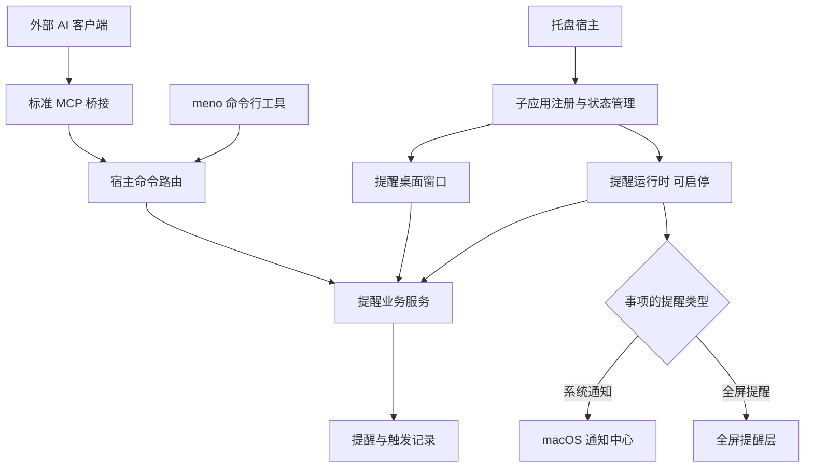

# Meno 托盘宿主与提醒子应用实现方案

状态：实现参考。接手开发请先阅读 [开发交接文档](HANDOVER-实现.md)，其中列明当前代码状态、开工默认值、实施任务和验收标准。

Meno 是一个常驻 macOS 菜单栏的功能宿主，用户在托盘中启停各个子应用，点击名称打开对应的桌面窗口。第一个子应用是“到点提醒”，支持快速创建、查看全部时间点，并为每条事项选择“系统通知”或“全屏提醒”。

Meno 本身不包含 AI，不接入模型、推理服务或模型 API Key。外部 AI 可以通过标准 MCP 接口操作 Meno：外部 AI 负责理解用户的话，Meno 接收明确参数，完成校验、保存和提醒。

## 产品边界

项目采用 monorepo，最终安装一个 `Meno.app`。每个子应用拥有完整的界面、数据、业务逻辑和运行生命周期，在仓库里独立维护。各子应用共享宿主进程，用户可以单独停止某个子应用的后台运行。

“打开窗口”和“后台运行”是两个独立动作：停止提醒的后台运行后，仍然可以打开提醒窗口、查看和编辑事项；这些事项会保存，但不会到点弹出提醒。重新开启后恢复未来的提醒。关闭窗口则只收起界面，后台运行状态保持原样。

| 对象 | 负责什么 | 用户如何使用 |
| --- | --- | --- |
| 托盘宿主 | 展示子应用、控制启停、管理窗口、通用设置、外部调用入口 | 点击菜单栏图标 |
| 提醒子应用 | 管理事项、时间和提醒类型，持久化并调度提醒 | 点击托盘中的“到点提醒” |
| 提醒窗口 | 展示所有提醒、快速新增、编辑、暂停单条提醒、查看历史 | 普通桌面窗口，可关闭后继续后台运行 |
| 系统通知 | 按事项设置发送 macOS 原生通知 | 在通知中查看或处理 |
| 全屏提醒层 | 对指定事项覆盖当前工作画面，展示文字和处理按钮 | 确认完成或选择稍后提醒 |

首版的“可插拔”包括独立模块接入和运行时启停：新增子应用时增加一个 package 并注册到宿主，随后重新构建 Meno。运行时下载第三方二进制、任意代码热加载和插件商店放在后续考虑。

## 托盘入口

宿主以托盘为主入口，正常启动后只显示菜单栏图标，不自动打开一个大型管理窗口。第一次启动可以展示简短引导，介绍如何开启第一个子应用。

```text
┌─────────────────────────────────┐
│ Meno                            │
│                                 │
│ 🔔 到点提醒                  [开] │
│    下一条：18:30 下班前收尾        │
│                                 │
│ 设置…                       退出 │
└─────────────────────────────────┘
```

点击子应用图标或名称，打开它自己的窗口；点击右侧开关，只改变后台运行状态。重复点击名称会把已有窗口带到前台，不重复创建相同窗口。停用时副标题显示“已暂停后台提醒”，仍可点击打开窗口。

托盘里的“退出 Meno”会停止所有子应用的后台任务并关闭提醒层。下次启动时恢复上次启用的子应用；用户也可在设置中选择登录时启动。

## 提醒桌面窗口

提醒窗口优先呈现“什么时候，需要做什么”，不依赖进入详情才能看到时间。窗口顶部一直保留快速创建入口，下方是按日期分组、按时间排序的提醒列表。

```text
┌─────────────────────────────────────────────────┐
│ 到点提醒                              运行中 ●   │
│                                                 │
│ [ 提醒内容：喝水                             ] │
│   5分钟后   10分钟后   30分钟后   自选时间         │
│   时间：今天 16:20   类型：[系统通知 ▾] [创建 ↵] │
│                                                 │
│ 今天                                            │
│ 16:20   喝水                系统通知·单次  [开] │
│ 18:30   下班前收尾          全屏提醒·工作日  [开] │
│                                                 │
│ 明天                                            │
│ 09:00   项目例会            系统通知·单次  [开] │
│                                                 │
│ [待提醒] [已暂停] [历史]                         │
└─────────────────────────────────────────────────┘
```

每条提醒直接展示时间、标题、提醒类型、重复规则和开关，编辑、删除等次要操作收进更多菜单。单次提醒到期后进入历史并保留处理状态；重复提醒继续展示下一次时间，历史记录保存每一次触发及处理结果。到期或通知被关闭不能自动当作事项已完成，只有明确确认才记录“已完成”。

“工作日”在首版明确表示周一至周五，不包含法定节假日和调休计算。日期分组、输入解析和提醒时间始终使用一致的时区规则。

停止后台运行时，窗口顶部持续显示“后台提醒已暂停，新增事项会保存，但不会到点弹出”，并提供一个启用按钮；无需在每次编辑时反复弹出确认。

## 提醒类型

提醒类型是每条事项独立保存的属性，同一列表可以同时存在系统通知和全屏提醒。创建和编辑时直接选择，Meno 不根据内容猜测类型。建议新事项默认“系统通知”，用户可以改成“全屏提醒”；默认值仍可在设置中调整。

| 类型 | 到点行为 | 常见用途 |
| --- | --- | --- |
| 系统通知 | 发送 macOS 原生通知，显示标题和备注，可配置声音 | 普通待办、短时事项、轻度提示 |
| 全屏提醒 | 显示全局蒙层与大字，由用户确认或延期 | 休息、喝水、需要明显提示的事项 |

首版每次触发使用一种展示方式，避免同一事项既弹系统通知又出现全屏蒙层。声音是单独设置，不作为第三种类型。通知权限被拒绝时保留事项并明确显示“系统通知未授权”，不会擅自改用全屏提醒；全屏提醒的运行不依赖通知权限。

修改类型时先撤销原类型对应的待触发任务，再按新类型重新安排。暂停单条事项或整个提醒子应用时，两种类型都停止后续触发。

## 快速创建提醒

主要路径是“填写内容 → 点选快捷时间 → 选择提醒类型 → 回车保存”，这些控件在同一个紧凑区域内完成，无需打开完整表单。默认类型已经选好，常用场景只需输入内容、点一下“10分钟后”然后回车；时间位置始终展示实际日期和时间，保存后清空内容并保持焦点。

更精确的日期、时间、重复规则和备注放在展开区域；点击“自选时间”直接使用原生日期时间控件。内容为空或单次时间已经过去时显示明确提示。输入框里的“喝水”“准备材料”就是标题，不需要由程序理解其含义。

固定格式快捷输入可以作为辅助，例如 `20m 喝水` 或 `明天09:00 开会`。实现方式是本地字符串匹配：识别约定的时间前缀，计算时间，把剩余文字作为标题；不调用 AI，也不推断任意中文表达。无法匹配时保留原始文字，让用户点选时间。首版先把点选式创建做好，固定语法不作为核心流程的依赖。

建议提供可配置的全局快捷键，直接打开一个小型快速创建面板，复用同一套内容、时间和类型控件。快捷键冲突时允许更换；具体默认组合键在交互确认时确定。

## 全屏提醒效果

图片一和图片二提供的是“到点后让用户看见”的交互参考：全局半透明覆盖层、中央大字、少量操作按钮。首版先实现文字、简单符号和柔和背景，不引入复杂插画、场景动画或休息倒计时。




### 提醒出现时

只有类型为“全屏提醒”的事项到点后，才在当前工作画面上显示柔和蒙层，中央显示提醒标题，可附一行备注和原定时间。背景可以看到原有窗口的轮廓，文字有足够对比度，淡入淡出，避免强烈颜色和闪烁。

建议默认覆盖所有连接的显示器，完整文字和操作按钮展示在鼠标所在屏幕，其余屏幕只显示同步蒙层。这样用户在外接屏工作时也能感知提醒，同时避免每个屏幕重复出现按钮。这个默认行为列在文末待确认项中。

```text
                 喝口水，休息一下

                  原定时间 16:20

             [知道了]    [5分钟后提醒]
```

“知道了”确认这一次提醒，单次事项完成，重复事项继续后续计划；“5分钟后提醒”产生一个延期的触发实例，不改变原有每天或工作日的时间。提醒默认保持显示，直到用户处理，不自动一闪而过。

提醒层覆盖其他窗口但不锁定系统，不要求关闭其他应用，也不模拟点击或接管系统输入。默认不切换用户的桌面空间、不主动抢走正在编辑的应用焦点；点击提醒面板后支持键盘处理，Esc 的具体语义与快捷键一起确认。

多条全屏提醒同时到点时合并在同一个提醒层中逐条展示，显示“还有 N 条”，避免堆叠多层遮罩；同时到点的系统通知仍按自身类型发送。关闭某个子应用时，立即关闭它已经显示的提醒层，并取消尚未展示的实例。

### 系统范围和限制

使用原生 `NSPanel` 和 SwiftUI 渲染提醒内容，并结合多桌面及全屏窗口行为实现全局展示。Apple 提供了用于加入所有桌面的 [`canJoinAllSpaces`](https://developer.apple.com/documentation/appkit/nswindow/collectionbehavior-swift.struct/canjoinallspaces) 和用于浮动窗口、系统覆盖层的 [`canJoinAllApplications`](https://developer.apple.com/documentation/appkit/nswindow/collectionbehavior-swift.struct/canjoinallapplications)；窗口采用不激活所属应用的 [`nonactivatingPanel`](https://developer.apple.com/documentation/appkit/nswindow/stylemask-swift.struct/nonactivatingpanel) 作为焦点策略的实现起点。

全屏应用、不同桌面空间、台前调度和多显示器组合需要真机验证，不能仅凭设置了窗口属性就视为验收通过。登录界面、锁屏、关机和系统安全界面不在覆盖范围；休眠期间不承诺准时显示，也不为提醒强制唤醒电脑。

系统通知是另一种独立的提醒类型，由 macOS 通知中心展示，受用户的通知权限、专注模式和锁屏显示设置影响。Meno 展示通知权限状态，并在提交失败时报告原因；系统通知已提交不代表用户一定已经看到或确认。[Apple 本地通知文档](https://developer.apple.com/documentation/usernotifications/scheduling-a-notification-locally-from-your-app)

## 视觉方向

整体参考图片三的低饱和灰色、柔和明暗和圆润形状，保留 macOS 原生的留白、字体和控件质感。图一的高亮蓝色不作为配色目标。



| 元素 | 建议方向 |
| --- | --- |
| 明亮背景 | 暖灰白 `#F3F2EE`，面板使用接近白色的浅灰 |
| 主要文字 | 柔和炭黑 `#2D2F2E` |
| 次要文字和分隔线 | 中性灰，减少强边框 |
| 少量强调 | 低饱和灰绿 `#5F756A`，用于运行状态和主要动作 |
| 深色模式 | 炭灰背景，米灰文字，保持同样的层次 |
| 提醒蒙层 | 半透明深灰或暖灰，按背景亮度保证可读性 |
| 图标与动效 | 简单线性符号、圆角、短暂淡入淡出 |

颜色值是设计起点，最终以浅色、深色和实际桌面背景下的可读性确认。首版不依赖壁纸图片表达核心信息，并适配系统的减少动态效果及降低透明度设置。

## 外部添加和 Codex 使用

首版提供标准 MCP Server，外部 AI 客户端接入后可以发现并调用创建、查询、修改、取消等工具。Meno 本身不运行模型，MCP 只是把这些操作作为结构化工具暴露出去；工具的输入使用 JSON Schema 描述，输出返回可检查的结构化结果。[MCP Tools 规范](https://modelcontextprotocol.io/specification/2025-11-25/server/tools)

你对外部 AI 说“20 分钟后全屏提醒我喝水”时，由外部 AI 把这句话转换成如下工具调用：

```json
{
  "name": "reminders_create",
  "arguments": {
    "title": "喝水",
    "reminderType": "fullscreen",
    "schedule": {
      "kind": "delay",
      "afterSeconds": 1200
    },
    "requestId": "drink-water-001"
  }
}
```

Meno 收到的是明确字段，不需要理解原句；它校验类型和时间，保存数据，检查后台与通知权限，返回实际提醒时间和运行状态。此后即使外部 AI 客户端关闭，已启用的 Meno 仍继续负责提醒。若需要普通系统提醒，只需将 `reminderType` 设为 `system`。

### 首版 MCP 工具

| 工具 | 职责 |
| --- | --- |
| `reminders_create` | 创建指定内容、时间、类型和重复规则的提醒 |
| `reminders_list` | 查询提醒，可按日期、状态、类型筛选 |
| `reminders_update` | 按 ID 修改内容、时间、类型或单条启用状态 |
| `reminders_cancel` | 按 ID 取消后续触发，保留历史记录 |
| `apps_get_status` | 查询子应用运行状态及系统通知权限状态 |
| `apps_set_enabled` | 显式启停指定子应用的后台运行 |

创建参数中，`title`、`schedule` 和 `requestId` 必填；`reminderType` 可取 `system` 或 `fullscreen`，省略时采用应用设置中的默认类型，并在回执中明确返回。`note` 可选，`enablePlugin` 默认为 `false`，传入 `true` 才显式开启原本停用的后台运行。

时间采用有明确分支的结构：单次绝对时间使用 `kind: once` 和带时区的 ISO 8601 `at`；相对时间使用 `kind: delay` 和正数 `afterSeconds`；每天与周一至周五分别使用 `kind: daily`、`kind: weekdays`，指定 `time` 和本地时区策略。参数冲突、无效类型、缺失内容和过去的单次时间返回明确错误，不由 App 猜测或修正。

每次成功写入返回提醒 ID、`saved`、`armed`、`reminderType`、`nextTriggerAt` 和运行受阻原因。`armed` 表示后台已启用且当前类型具备所需条件，不承诺系统通知一定显示在屏幕上。保存成功但后台停用或系统通知未授权时，返回 `saved: true, armed: false`，同时解释具体原因。

### MCP 接入方式

随 `Meno.app` 打包一个 `meno-mcp` 辅助可执行文件，使用本地 stdio 传输，由外部 MCP 客户端按需启动；它没有独立桌面界面，不增加另一个需要用户管理的 App。标准输出仅传输 MCP 消息，日志写到标准错误。[MCP stdio 规范](https://modelcontextprotocol.io/specification/2025-11-25/basic/transports)

优先采用官方 [MCP Swift SDK](https://github.com/modelcontextprotocol/swift-sdk) 完成协议握手、工具注册和传输，不手写一套“类似 MCP”的私有协议。具体依赖版本在实现时锁定。

`meno-mcp` 将工具请求通过本机 Unix domain socket 转给宿主，宿主统一调用提醒业务服务。MCP 进程结束只断开外部入口，不停止已创建的提醒；客户端连接和工具发现也不自动开启任何子应用。设置页提供可执行文件路径及接入说明，按用户选择的 MCP 客户端生成相应配置。

### 命令行入口

同时保留 `meno` 命令行工具，供 Shell 脚本和手动调试使用，和 MCP 复用同一套业务命令与返回结构，不要求外部 AI 必须通过 Shell 操作。

```sh
# 二十分钟后发送系统通知
meno reminders add --title "喝水" --in 20m --type system --json

# 每天固定时间全屏提醒
meno reminders add --title "站起来活动" --daily 15:00 --type fullscreen --json

# 查看提醒和运行状态
meno reminders list --json
meno apps status reminders --json

# 显式启用提醒子应用，再添加事项
meno reminders add --title "喝水" --in 20m --type fullscreen --enable-plugin --json

# 按返回的 ID 修改、取消；避免依赖模糊的名称匹配
meno reminders update <id> --in 30m --json
meno reminders cancel <id> --json
```

以上为拟定接口，具体参数和工具安装方式会随实现文档一起固定。CLI 的 `--in`、`--daily`、`--weekdays` 和 `--at` 互斥，类型使用 `--type system|fullscreen`。外部调用不直接修改数据库、写入数据文件或模拟点击界面。

### 运行状态的约定

| 场景 | 建议行为 |
| --- | --- |
| 宿主已运行，提醒已启用，所选类型可用 | 保存后立即进入调度，返回 `saved: true, armed: true` |
| 宿主已运行，提醒已停用 | 允许保存，返回 `saved: true, armed: false`，明确说明后台已暂停 |
| 系统通知权限被拒绝 | 保存事项，返回 `armed: false` 和通知权限原因，不改为全屏类型 |
| 显式传入 `enablePlugin: true` 或 `--enable-plugin` | 启用提醒运行时并完成创建；是否进入调度仍取决于所选类型的条件 |
| 实际业务调用时宿主未运行 | 自动以后台模式启动 Meno，再执行请求；不弹管理窗口 |
| 参数无效、保存失败或启动失败 | CLI 返回非零退出码，MCP 返回错误结果；均包含具体原因，不宣称创建成功 |

外部调用不能把“写入成功”等同于“到点一定会展示”。CLI 使用退出码和 JSON 表达结果，MCP 使用结构化工具结果，并在业务执行失败时设置 `isError`。外部 AI 应依据回执答复，停用时保存的默认行为见文末。

### 通信与可靠性

MCP 桥接与 CLI 都通过仅限本机当前用户访问的 Unix domain socket 调用宿主，宿主是提醒数据的唯一写入方。窗口、MCP 和 CLI 操作进入同一个串行服务，完成数据事务后才返回成功，并向已打开窗口推送变更。

MCP 写操作要求提供 `requestId`，相同 ID 与相同参数重试时保留原写入结果，包括原来计算的相对提醒时间；`armed` 等当前运行状态重新查询后返回，避免返回过期状态。相同 ID 对应不同参数时返回冲突错误。CLI 可通过 `--request-id` 使用相同机制。幂等记录和提醒变更在同一事务内保存，防止响应丢失后重试产生重复事项。连接失败时区分“宿主未启动”和“插件未启用”，启动等待设置超时。首版不开放局域网 HTTP 服务。

URL Scheme 可在后续补充为网页或快捷指令入口；首版先把标准 MCP 和共用业务接口做完整。若需要 URL 跳转，macOS 提供 [`application(_:open:)`](https://developer.apple.com/documentation/appkit/nsapplicationdelegate/application(_:open:)) 处理注册过的 URL 类型。

## Monorepo 和模块职责

```text
Meno/
├── apps/
│   ├── Meno/                    # 菜单栏宿主和 macOS 窗口管理
│   ├── MenoMCP/                 # 标准 MCP stdio 桥接，无独立界面
│   └── MenoCLI/                 # 脚本与手动调用工具
├── packages/
│   ├── MenoPluginKit/           # 描述信息、运行时协议与窗口契约
│   └── MenoControlProtocol/     # MCP、CLI 与宿主共用的命令及回执
├── plugins/
│   └── Reminders/               # 完整提醒子应用，独立 Swift package
│       ├── Sources/
│       │   ├── RemindersCore/   # 提醒模型、时间规则和存储
│       │   └── RemindersPlugin/ # 窗口、调度、系统通知、全屏层、命令处理
│       └── Tests/
├── scripts/                     # 构建、打包、本地运行
└── docs/                        # 方案、插件接入、MCP 与 CLI 说明
```

宿主不处理“喝水多久提醒一次”之类的业务规则，只理解子应用的标识、图标、运行状态、窗口入口和命令入口。提醒子应用也不直接管理其他子应用的开关或数据。

插件契约将“模块定义”“窗口”“运行时”分开：模块定义提供描述信息和工厂；窗口按需创建；运行时只在启用后实例化并启动。外部命令可以按需执行数据操作，但不能隐式启动被停用的后台运行时。



独立 package 帮助保持代码和依赖边界，但首版共享同一个进程，不提供插件崩溃的进程级隔离。运行时停止后不保留定时器、系统观察者、待展示提醒或覆盖层；窗口存在时可保留用于查看和编辑的数据服务。

## 数据与调度

建议使用原生 Swift、SwiftUI 和 AppKit，最低支持 macOS 14。提醒数据使用系统 SQLite，保存提醒定义和每次触发记录；宿主偏好与插件启用状态单独保存。所有数据本地存储，首版不依赖账号或云服务。

提醒定义保存标题、备注、提醒类型、启用状态、时间规则、时区策略、创建来源和下一次触发时间；触发记录保存本次原定时间、提交或展示状态、确认或延期结果。来源区分界面、MCP 和 CLI，并由实际入口记录，便于查询与排查。系统通知不能仅因提交成功就记录成“已展示”或“已完成”。

调度器串行处理变更，按事项类型分发：系统通知通过 `UNUserNotificationCenter` 安排，全屏提醒由进程内定时器触发。全屏调度只维护最近一次触发需要的定时器，增删改后重新计算，不通过每秒扫描所有事项来工作。提交或展示前持久化本次实例，后续动作更新记录；重复提醒按原定时间计算下一次，不因用户晚确认而持续后移。

提醒类型、内容或时间变更时，按稳定的提醒和触发实例标识撤销旧任务并提交新任务。重启后核对本地记录与系统仍存在的通知请求，避免重复安排。外部调用和界面操作使用同一套校验与调度流程，不分别维护规则。

| 场景 | 建议处理规则 |
| --- | --- |
| 普通单次提醒 | 在明确的绝对时间触发 |
| 每天或周一至周五 | 按本地墙上时钟计算，例如始终是当地 15:00 |
| 时区或系统时间变化 | 重算下一次触发时间；单次提醒保留原定绝对时刻 |
| 电脑休眠后唤醒 | 全屏提醒按 30 分钟补偿窗口处理；系统通知先核对已提交及送达记录，不重复补发 |
| 主动停用或主动退出期间到期 | 不补弹，记录为暂停期间错过；重新启用后恢复未来计划 |
| 意外退出后重新启动 | 恢复未完成记录，按补偿规则处理，防止重复弹出 |
| 同一时刻多条事项 | 全屏提醒合并入展示队列；系统通知按各自请求发送，同一事项不双重展示 |
| 停用子应用 | 取消定时器、观察者、待展示队列、覆盖层和待触发系统通知；保留数据 |

唤醒后的重算可以接入 macOS 的 [`didWakeNotification`](https://developer.apple.com/documentation/appkit/nsworkspace/didwakenotification)。锁屏期间不展示全屏提醒，恢复到可交互桌面后再应用补偿规则；系统通知的锁屏显示遵循系统设置。两种类型都必须遵守子应用停用的语义。

30 分钟补偿窗口是建议默认值，目的是避免解锁后连续弹出很久以前的事项。夏令时不存在的时刻顺延到下一个有效时刻，重复出现的时刻当天只触发一次，这些时间规则需要有针对性的测试。

## 首版范围和验收

| 首版必须具备 | 后续扩展 |
| --- | --- |
| 托盘入口、子应用独立开关、独立桌面窗口 | 插件商店、二进制热加载、进程隔离 |
| 单次、每天、周一至周五提醒 | 节假日、复杂日历规则、地点提醒 |
| 内容、快捷时间、提醒类型同屏创建，支持精确编辑 | 固定语法快捷输入、常用模板 |
| 每条事项选择系统通知或全屏提醒，支持确认与延期 | 场景插画、休息倒计时、复杂动画 |
| 全屏文字覆盖层、多屏适配 | 更多展示主题和布局 |
| 本地存储、恢复与遗漏处理 | 云同步、多设备同步 |
| 标准 MCP 增查改取消、子应用状态及启停、结构化回执和幂等 | 网络 API、URL 创建入口 |
| 共用业务协议的 CLI 工具 | 更多脚本集成方式 |
| 全局快速创建快捷键、登录启动设置 | 更复杂的自动化组合和跨插件流程 |

验收围绕真实使用完成：从托盘打开提醒窗口，输入“喝水”、选择一分钟后的时间及提醒类型并回车，窗口立即展示准确时间和类型。分别创建系统通知与全屏提醒，关闭窗口后验证各自展示方式正确，单条事项不会同时触发两种展示；确认或延期后记录正确变化。全屏类型额外在多屏、全屏应用、桌面空间切换、锁屏恢复和休眠恢复下实测。

随后验证停用语义：保持提醒窗口打开并停止后台运行，窗口仍能编辑，但到点不弹出；重新开启只恢复未来计划。关闭一个子应用不影响宿主和其他子应用，退出宿主后所有后台运行结束。

外部入口首先通过真实 MCP 客户端完成工具发现、新增、查询、修改和取消，确认两种提醒类型都可创建且界面同步；宿主未启动时可后台启动；插件停用或系统通知未授权时回执明确为未进入调度；相同 `requestId` 重试不重复创建、不重新计算相对时间。关闭 MCP 客户端后，已进入调度的提醒继续运行。CLI 对同一业务接口执行对应验证。

自动化测试覆盖结构化参数校验、类型切换、通知权限、重复规则、夏令时、延期、遗漏补偿、停止与触发并发、事务和幂等；覆盖层的视觉、焦点和系统窗口行为需要真机验收。App 的创建、保存和提醒流程在没有模型、没有模型密钥的情况下均可独立使用。

## 实施顺序

先完成托盘宿主、窗口路由和运行生命周期，使“停止后台”和“关闭窗口”确实分离；再定义提醒类型、数据和共用业务命令，完成快速创建；随后接通系统通知与全屏提醒并验证各自行为；再接入标准 MCP 和 CLI，完成恢复逻辑与整体视觉验收。MCP 是首版交付项，业务命令从一开始按外部调用需求设计。

当前仓库已有初始试验骨架，尚不代表本方案已经实现。后续需按本方案调整为托盘入口和子应用窗口分离，并补齐双类型提醒、快速创建和 MCP 外部入口。具体开工任务及现有验证结果见 [开发交接文档](HANDOVER-实现.md)。

## 优先对齐的默认行为

已确定 App 本身不含 AI，每条事项可选择系统通知或全屏提醒，首版提供标准 MCP 给外部 AI 调用。下面是仍可调整的默认行为。

| 事项 | 本稿建议 |
| --- | --- |
| 新提醒的默认类型 | 系统通知；用户可以逐条选择全屏提醒，也可以修改默认设置 |
| 全屏提醒的强度 | 覆盖所有屏幕，鼠标所在屏幕显示文字和按钮，保持到用户处理；可完成或延后 5 分钟 |
| 停用时新增事项 | 允许保存和编辑，明确显示后台暂停；外部命令也可保存，但只有显式启用后才调度 |
| 快速创建 | 内容、快捷时间和提醒类型同屏点选；固定格式输入作为后续辅助，App 不使用 AI |
| 可插拔的第一阶段 | 独立 package、统一契约、运行时独立启停；新增代码后重新构建，后续再考虑热安装 |
